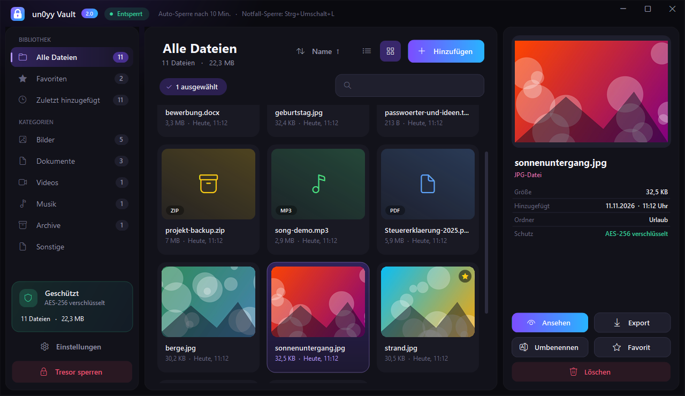
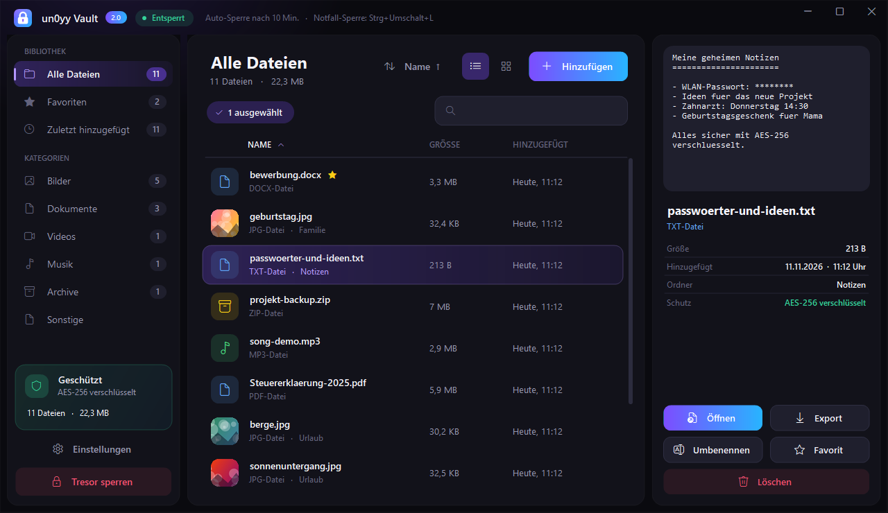
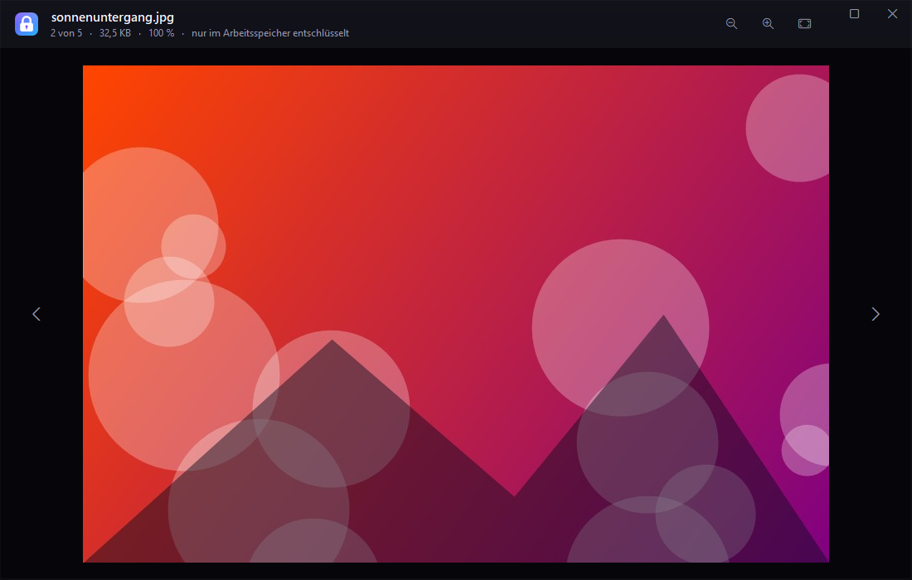
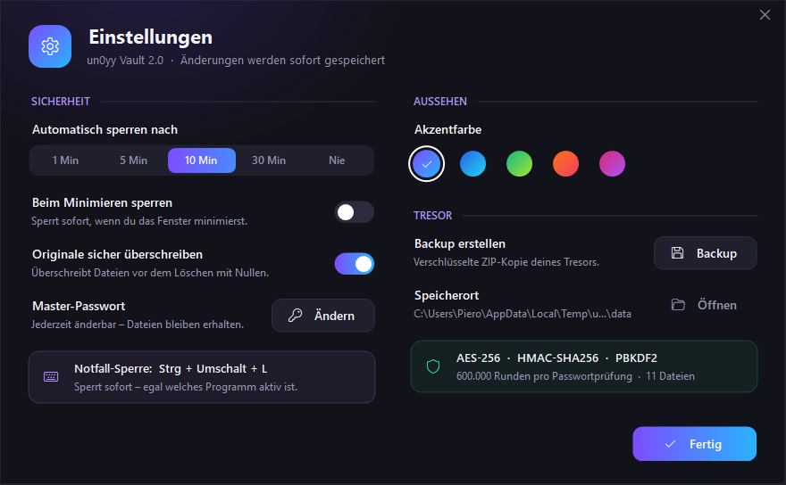
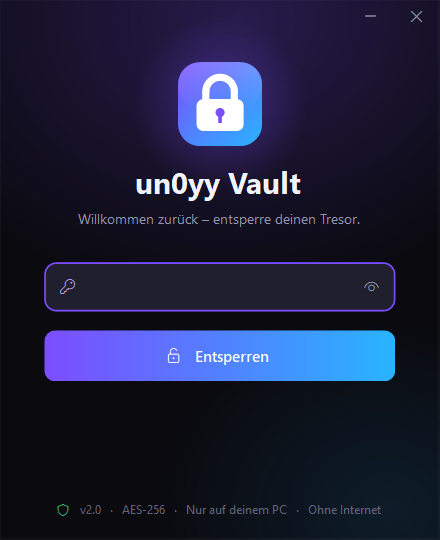

<div align="center">

# 🔐 un0yy Vault 2.0

**A private, password-protected safe for your files – one small `.exe`, no install, no internet.**


**[⬇️ Download the latest version](https://github.com/un0yy-sasse/un0yy-forge/releases/latest)**

<br>



</div>

---

## ✨ What it can do

### 🛡️ Security
- 🔑 **Master password** – without it nobody can open your files
- 🔒 **AES-256** encryption + **HMAC-SHA256** tamper protection
- 🧱 **PBKDF2-SHA256 with 600 000 rounds** – old vaults are upgraded automatically
- 🙈 **File names are encrypted too** – the data folder only contains random `.bin` files
- 👁️ **Previews never touch the disk** – images and texts are decrypted in memory only
- 🚨 **Panic hotkey `Ctrl + Shift + L`** – locks instantly, from any program
- ⏱️ **Auto-lock** (1 / 5 / 10 / 30 min or never) and optional **lock on minimize**
- 🐢 Growing wait time after wrong passwords, Caps-Lock warning
- 🧹 Optionally deletes the originals – **overwritten with zeros first**

### 🎨 Comfort
- 🖼️ **Grid view with real thumbnails** or a classic list – one click to switch
- 🔍 **Preview panel** for pictures and text files, built-in **image viewer** (zoom, pan, ← →)
- ✏️ **Edit files directly** – open in Word & co., changes are re-encrypted automatically on save
- ⭐ **Favourites**, 🕒 **recently added**, categories (pictures, documents, videos, music, archives)
- 🔎 Search (`Ctrl+F`), sort by name / size / date, rename (`F2`), paste files (`Ctrl+V`)
- 📦 Drag & drop files **and whole folders**, with a live progress bar
- 💾 **Encrypted backup** as ZIP with one click
- 🌈 5 accent colours, borderless dark design, sharp on high-DPI screens

<div align="center">

<br><br>

<br><br>
 
</div>

## 🚀 How to use

1. Download **`un0yy-vault.exe`** from [Releases](https://github.com/un0yy-sasse/un0yy-forge/releases/latest)
2. Put it in its own folder (e.g. `Documents\un0yy Vault\`) and double-click it
3. Choose a master password → **Tresor erstellen**
4. Drag files into the window – done ✅

**Updating from v1:** just replace the old `.exe` – your vault opens as before.

> ⚠️ **If you forget your password, the files are gone forever.** There is no reset – that's the point.

> 📁 Everything is stored in **`un0yy-vault-data`** next to the `.exe`. Keep both together; for a backup use *Settings → Backup*.

> 🪟 Windows SmartScreen may warn the first time ("Unknown publisher") because the exe is not code-signed.
> Click **More info → Run anyway**.

## ⌨️ Shortcuts

| Key | Action |
| :-- | :-- |
| `Ctrl + Shift + L` | Panic lock (works everywhere) |
| `Ctrl + L` | Lock |
| `Ctrl + F` | Search |
| `Ctrl + O` / `Ctrl + V` | Add files / paste files |
| `Enter` / double-click | Open (pictures open in the viewer) |
| `F2` | Rename (`/` in the name creates a folder) |
| `Del` | Delete from the vault |
| `Ctrl + A`, `Shift` / `Ctrl` + click | Multi-select |

## 🛠️ Build it yourself

No extra tools needed – uses the C# compiler that ships with Windows:

```powershell
powershell -ExecutionPolicy Bypass -File build.ps1
```

The exe ends up in `dist\`. The build also runs a self-test of the encryption (wrong password, tampering, rename, edit-sync, …).

## 📄 Files

| File | |
| :-- | :-- |
| `src/Vault.cs` | encryption & storage |
| `src/UiCore.cs` | design system & controls |
| `src/UiViews.cs` | file list, thumbnails, preview, image viewer |
| `src/UiForms.cs` | login, dialogs, settings |
| `src/MainForm.cs` | main window |
| `src/Program.cs` | start-up, settings, self-test |
| `build.ps1` | build script (icon + exe + self-test) |
