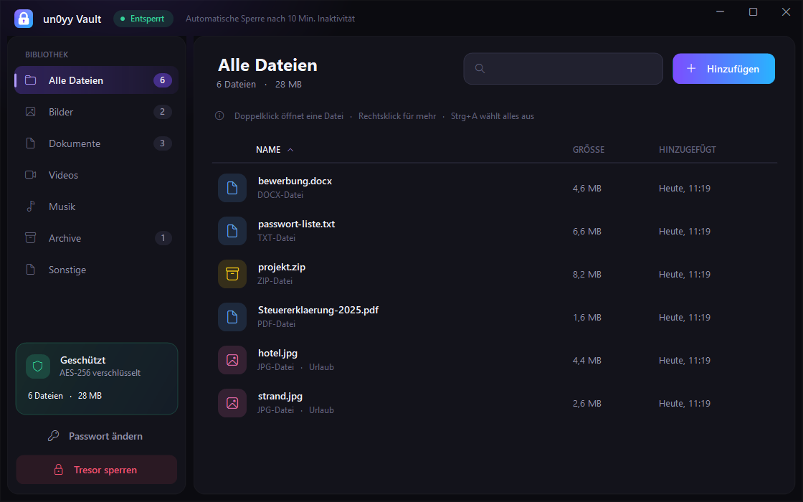
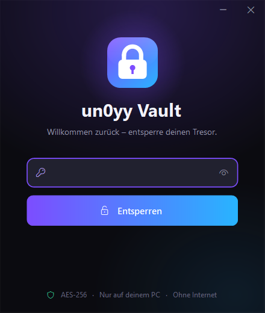
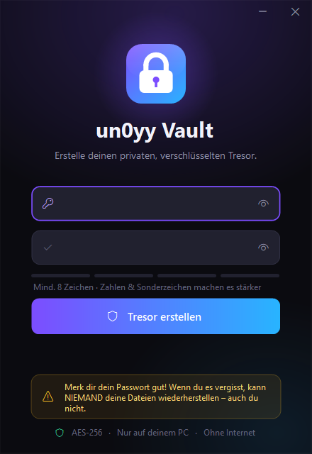

<div align="center">

# 🔐 un0yy Vault

**A private, password-protected safe for your files – one small `.exe`, no install.**


<br>



 

</div>

---

## ✨ Features

- 🔑 **Master password** – without it nobody can open your files
- 🛡️ **AES-256 encryption** + HMAC-SHA256 tamper protection, PBKDF2-SHA256 (310 000 rounds)
- 🙈 **File names are hidden too** – the data folder only contains random `.bin` files
- 🖱️ **Drag & drop** files *and* whole folders into the window
- 🧹 Optionally deletes the unprotected originals after adding them
- ⏱️ **Auto-lock** after 10 minutes without activity
- 🐢 Brute-force protection: waiting time grows after wrong passwords
- 🔁 Change your password at any time
- 🗂️ Sidebar with categories (pictures, documents, videos, music, archives), search & sorting
- 🌙 Modern borderless dark design, German UI, ~110 KB, no installation, no internet

## 🚀 How to use

1. Download **`un0yy-vault.exe`** from [Releases](https://github.com/un0yy-sasse/un0yy-forge/releases)
2. Put it in its own folder (e.g. `Documents\un0yy Vault\`) and double-click it
3. Choose a master password → **Tresor erstellen**
4. Drag files into the window – done ✅

> ⚠️ **If you forget your password, the files are gone forever.** There is no reset – that's the point.

> 📁 The app stores everything in the folder **`un0yy-vault-data`** next to the `.exe`.
> Always keep the `.exe` and that folder together. For a backup, copy both.

> 🪟 Windows SmartScreen may warn the first time ("Unknown publisher"), because the exe is not code-signed.
> Click **More info → Run anyway**.

## 🛠️ Build it yourself

No extra tools needed – uses the C# compiler that ships with Windows:

```powershell
powershell -ExecutionPolicy Bypass -File build.ps1
```

The exe ends up in `dist\`. The build also runs a self-test of the encryption.

## 📄 Files

| File | |
| :-- | :-- |
| `src/Vault.cs` | encryption & storage |
| `src/Ui.cs` | user interface |
| `screenshots/` | pictures for this page |
| `build.ps1` | build script (icon + exe + self-test) |
